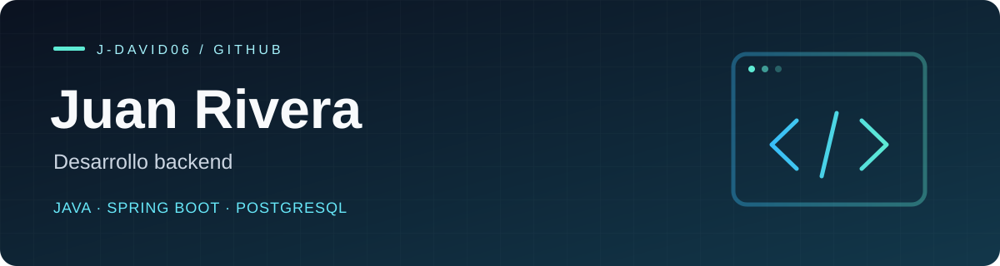

  

  <a href="#sobre-mí">Sobre mí</a> ·
  <a href="#tecnologías">Tecnologías</a> ·
  <a href="#proyectos-destacados">Proyectos</a> ·
  

## Sobre mí

Hola, soy **Juan Rivera** 👋

Mi trabajo en GitHub se centra en el **desarrollo backend con Java y Spring Boot**. Construyo proyectos que conectan reglas de negocio, APIs y bases de datos, con especial interés en la automatización de finanzas personales y los sistemas de logística.

- **En construcción:** automatización de finanzas personales para Colombia e ingesta de movimientos desde iOS.
- **Enfoque técnico:** separar el dominio de la infraestructura, validar reglas de negocio y mantener la consistencia de los datos.
- **Forma de trabajar:** cambios revisables, pull requests, documentación y pruebas.

## Tecnologías

Herramientas presentes en mis proyectos públicos:

**Backend**

**Datos e infraestructura**

## Proyectos destacados

### [Finanzas personales](https://github.com/j-david06/proyecto-finanzas)

Backend para automatizar el registro de movimientos financieros en Colombia, con ingesta desde iOS y procesamiento de eventos.

**Java 21 · Spring Boot · PostgreSQL · Flyway · Docker**

- Dominio independiente del framework y validaciones financieras.
- Webhook autenticado, control de duplicados e inbox cifrado.
- Worker de procesamiento y panel de demostración local.

[Explorar código y documentación →](https://github.com/j-david06/proyecto-finanzas#readme)

### [Gestión logística de paquetes](https://github.com/j-david06/20261LogisticsPackages)

Participación en un proyecto de práctica de ingeniería de software cuyo alcance abarca trazabilidad de paquetes, planificación de rutas y facturación.

**Java · Reglas de negocio · Trabajo colaborativo**

Repositorio derivado de [InsoftUnimag/20261LogisticsPackages](https://github.com/InsoftUnimag/20261LogisticsPackages).

[Explorar el proyecto →](https://github.com/j-david06/20261LogisticsPackages#readme)

## Colaboración

¿Compartes interés por Java, automatización o diseño de sistemas? Puedes explorar mis proyectos y conversar sobre mejoras en sus issues y pull requests.

  <a href="https://github.com/j-david06?tab=repositories">Ver mis repositorios</a>

