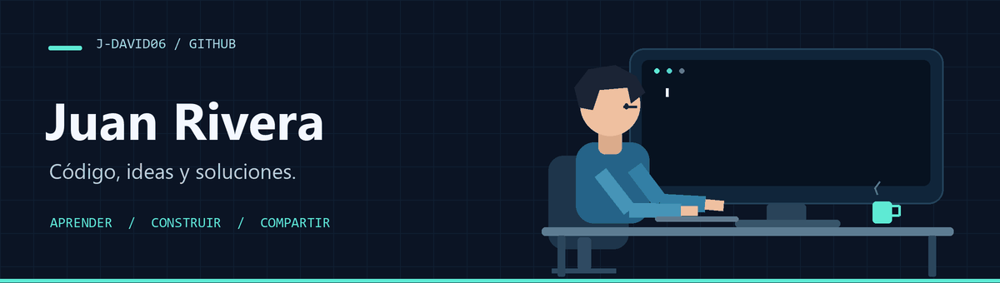

  

  <a href="#sobre-mí">Sobre mí</a> ·
  <a href="#tecnologías">Tecnologías</a> ·
  <a href="#proyectos-destacados">Proyectos</a> ·
  

## Sobre mí

Hola, soy **Juan Rivera**

Estudiante de **Ingeniería de Sistemas en la Universidad del Magdalena**, actualmente en **octavo semestre**, en Santa Marta. Mi enfoque principal es el **desarrollo backend y la arquitectura de software**, con experiencia en microservicios y arquitectura hexagonal, complementado con desarrollo web en React.

- **Bases sólidas:** Java, C++, programación estructurada y orientada a objetos; Clean Code y SOLID.
- **Experiencia colaborativa:** plataformas de turismo y logística con microservicios, además de automatización de finanzas personales.
- **Trabajo en equipo:** capacidad para comunicar conceptos técnicos, acompañar la resolución de problemas y colaborar en el desarrollo de software.
- **Quiero aprender:** integración de soluciones con IA y desarrollo de aplicaciones móviles.

## Tecnologías

Tecnologías que he aplicado en proyectos y durante mi formación:

**Backend**

**Frontend web**

**Datos e infraestructura**

Trabajo también con **C++**, **SQL**, **WSL / Ubuntu**, **GitHub Pages** y **VS Code**. Utilizo herramientas de desarrollo asistido por IA, entre ellas Claude y Codex.

**Formación académica y laboratorios**

- **Estructuras de datos:** trabajo con C++ y Java.
- **Algoritmos:** formación y ejercicios con C++ y C.
- **Bases de datos:** formación académica con MySQL y SQL.
- **Redes:** fundamentos OSI y Ethernet, subredes IPv4, VLAN y enrutamiento estático y dinámico (RIP, OSPF y EIGRP), con prácticas en Cisco Packet Tracer.
- **Ingeniería de software:** aplicación en el proyecto de gestión logística de paquetes.
- **Matemáticas de ingeniería:** formación matemática como parte de Ingeniería de Sistemas.
- **C y Sistemas Operativos:** procesos POSIX, comunicación entre procesos, señales y memoria.
- **Python y scikit-learn:** algoritmos de búsqueda y clasificación de texto en Inteligencia Artificial.
- **R:** modelado de dinámica de sistemas.

## Proyectos destacados

### [Samaria360](https://github.com/Al3jooo/Samaria360)

Participación en una plataforma de turismo de Santa Marta, desarrollada en equipo como proyecto de Arquitectura de Software.

**Stack del proyecto:** Java · Spring Boot · React · TypeScript · PostgreSQL · MongoDB · RabbitMQ · Docker

Contribuciones en funcionalidades de reservas y catálogo, interfaces de usuario y correcciones de calidad. El prototipo combina microservicios y arquitectura hexagonal.

- Reservas y disponibilidad: aportes al inventario de cupos y su integración con el catálogo.
- Frontend: pantallas de detalle, reserva y consulta de reservas con React.
- Correcciones de funcionamiento e interfaz, con trazabilidad en la documentación del equipo.

[Explorar el proyecto →](https://github.com/Al3jooo/Samaria360#readme) · [Ver mis pull requests →](https://github.com/Al3jooo/Samaria360/pulls?q=is%3Apr+author%3Aj-david06)

### [Finanzas personales](https://github.com/j-david06/proyecto-finanzas)

Backend para automatizar el registro de movimientos financieros en Colombia, con ingesta desde iOS y procesamiento de eventos.

**Java 21 · Spring Boot · PostgreSQL · Flyway · Docker**

- Dominio independiente del framework y validaciones financieras.
- Webhook autenticado, control de duplicados e inbox cifrado.
- Worker de procesamiento y panel de demostración local.

[Explorar código y documentación →](https://github.com/j-david06/proyecto-finanzas#readme)

### [Gestión logística de paquetes](https://github.com/j-david06/20261LogisticsPackages)

Participación en el módulo de gestión de paquetes de una plataforma logística, con separación entre dominio, casos de uso e infraestructura. La documentación describe la integración con el módulo de rutas mediante AWS SQS.

**Java · Spring Boot · PostgreSQL · React · AWS SQS**

- Historial de transiciones en los flujos de admisión, almacenaje y clasificación.
- Corrección del manejo del estado inicial del paquete para evitar errores en el seguimiento.
- Selector dinámico de sedes en la interfaz de admisión.

Repositorio derivado de [InsoftUnimag/20261LogisticsPackages](https://github.com/InsoftUnimag/20261LogisticsPackages).

[Explorar el proyecto →](https://github.com/j-david06/20261LogisticsPackages#readme) · [Ver mis pull requests →](https://github.com/InsoftUnimag/20261LogisticsPackages/pulls?q=is%3Apr+author%3Aj-david06)

## Colaboración

¿Compartes interés por Java, automatización o diseño de sistemas? Puedes explorar mis proyectos y conversar sobre mejoras en sus issues y pull requests.

  <a href="https://github.com/j-david06?tab=repositories">Ver mis repositorios</a>

